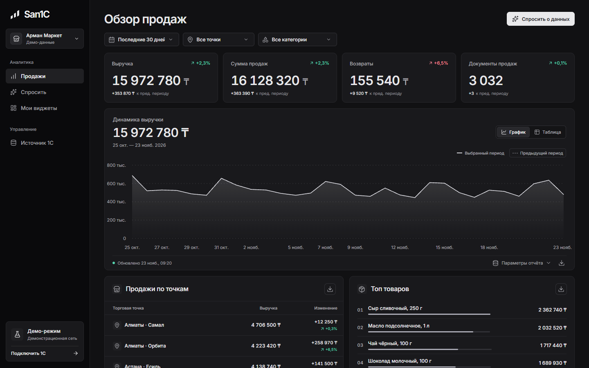
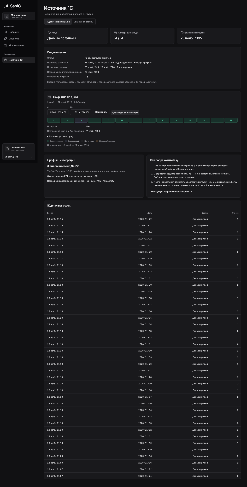
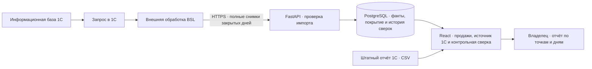

# San1C

 

**San1C** собирает аналитику продаж и возвратов из 1С и помогает владельцу быстро сверить сеть по точкам, дням и товарам. Система показывает, насколько свежи данные и какие дни ещё нужно подтвердить. Владелец может задать вопрос по-русски и сохранить отчёт на дашборде.

**Состояние MVP.** Локально проверена цепочка на учебной файловой базе 1С 8.5.1.1343. За две недели передачи повтор, исправление документа и отмена проведения сошлись с независимым запросом в 1С по всем 28 сочетаниям дня и точки. Совместимость с УТ Казахстан 3.4 ожидает проверки на копии конкретного релиза.



[Скриншоты интерфейса и нативной сверки](docs/screenshots/README.md) · [Архитектура](docs/ARCHITECTURE.md) · [План пилота](docs/ROADMAP.md) · [Паспорт подключения 1С](docs/pilot.md) · [Результаты пилота](docs/pilot-result.md) · [Развёртывание компании](deploy/pilot/README.md)

## Что уже работает

- Дашборд выручки, продаж, возвратов, документов, динамики, точек и товаров.
- Ответы на поддерживаемые вопросы на русском языке с просмотром фильтров и исходных показателей.
- Сохранение отчётов на дашборде и их пересчёт по актуальным данным.
- Дневные снимки 1С с безопасным повтором, обнаружением пропущенных дней и повторной загрузкой исправлений.
- Сверка с контрольным CSV по точкам, дням и сумме за период.
- Отдельные роли владельца и администратора, отзывной ключ импорта, HTTPS, резервное копирование и восстановление.

## Пример экрана



## Запуск

В каталоге проекта выполните команду на компьютере с Docker и Compose v2.

```sh
docker compose up --build -d --wait
```

Откройте [San1C на этом компьютере](http://127.0.0.1:8088). При запуске приложение применяет миграции Alembic и загружает демосеть «Арман Маркет». Для демо достаточно Docker. Оно работает без подключения к 1С, ключа модели и учётной записи. PostgreSQL хранит данные в именованном томе. Команда `docker compose stop` останавливает сервисы с сохранением данных.

### Первый отчёт

1. Откройте «Продажи». Выберите точку или категорию и сравните график, карточки и таблицы. Нажатие на точку в таблице показывает её товары. Кнопки экспорта скачивают текущие строки в CSV.
2. Верните все точки и категории. В разделе «Спросить» выберите «Где сильнее всего упала выручка за прошлую неделю?». При желании введите этот вопрос вручную.
3. Проверьте даты двух недель и абсолютное изменение в тенге по каждой точке. Раскройте «Параметры отчёта», чтобы увидеть фильтры, формулу, источник и свежесть.
4. Нажмите «Сохранить на дашборд». Откройте «Мои виджеты» и обновите страницу. Сохранены исходный вопрос, метрика, правило периода, группировка, фильтры и вид отображения. При чтении виджета сервер пересчитывает результат по актуальным фактам. Демо-виджеты принадлежат браузеру по cookie, рабочие виджеты принадлежат компании.

Демо содержит 120 дней истории четырёх вымышленных точек, несколько категорий, продажи и возвраты. При смене дня генератор достраивает данные по календарю `Asia/Almaty`. Ещё три поддерживаемых вопроса доступны среди примеров.

- «Покажи выручку по дням за последние 30 дней».
- «Какие 5 товаров дали больше всего выручки за этот месяц?»
- «Покажи возвраты по точкам за прошлый месяц».

## Показатели и покрытие

| Показатель | Расчёт внутри выбранных периода, точки и категории |
| --- | --- |
| Продажи | Сумма строк проведённых продаж в KZT после скидок, включая НДС |
| Возвраты | Сумма проведённых возвратов, отнесённых к собственной бизнес-дате возврата |
| Выручка | Продажи минус возвраты |
| Документы продажи | Число различных идентификаторов документов продажи, имеющих хотя бы одну строку в выборке |
| Изменение выручки | Выручка текущего периода минус выручка предыдущего, в KZT |
| Изменение в процентах | Изменение / выручка предыдущего периода × 100. При нулевой или отрицательной базе выводится «Нет базы для процента» |

Суммы строк неотрицательны. Знак задаёт тип операции. Денежные расчёты используют PostgreSQL NUMERIC и Python Decimal. Строка API содержит бизнес-дату, идентификаторы документа и позиции, идентификаторы и названия точки, товара и категории, тип, количество и сумму. Данные покупателей в контракт не входят.

Прошлая неделя закончилась в последнее **завершённое** воскресенье и началась в понедельник. Для вопроса о падении она сравнивается с предшествующей полной неделей. Последние 30 дней включают текущий местный день. «Этот месяц» охватывает дни с первого числа до текущего дня, «прошлый месяц» охватывает предыдущий календарный месяц целиком. Даты на экране включают обе границы. Нативный запрос к 1С выбирает полуоткрытый интервал от начала дня до начала следующего дня. Компания задаёт свой часовой пояс IANA через `COMPANY_TIMEZONE`.

Подтверждённый полный снимок с нулём строк означает день без операций. Отсутствующий снимок или обнаруженная неполная передача образуют пропуск. При неудачной новой версии последняя принятая версия остаётся в хранилище. Пока специалист заново не подтвердит день, суммы по нему исключаются из отчётов, в графике виден разрыв. При пропуске в любом из двух периодов сервис отмечает сравнение как неполное и воздерживается от вывода о снижении. При параллельной синхронизации части одного отчёта читаются в одной версии PostgreSQL (`REPEATABLE READ`).

## Подключение рабочей базы

Для пилота используйте отдельный Compose-проект на компанию с HTTPS, собственной PostgreSQL, отдельными учётными данными и профилем, смонтированным только для чтения. Команда `deploy/pilot/pilot.py` создаёт приватный каталог вне Git. Владелец читает отчёты, сохраняет виджеты и сверки. Администратор дополнительно управляет источником, отзывает токен и выпускает замену. После отзыва повторное создание контейнера сохраняет запрет старому токену. [Установка и операции](deploy/pilot/README.md).

При самостоятельной настройке стандартного Compose команда `docker compose run --rm --no-deps app python -m app.auth` выдаёт хеши двух разных паролей и отдельный ключ загрузки. Хеши `OWNER_PASSWORD_HASH`, `ADMIN_PASSWORD_HASH`, `UPLOAD_TOKEN_SHA256` и часовой пояс задаются вне Git, для HTTPS задайте `SESSION_COOKIE_SECURE=1`. Старый экземпляр с единственным `ADMIN_PASSWORD_HASH` продолжает предоставлять роль владельца. Чтобы включить две роли, задайте отдельные значения обоих хешей. После отзыва или замены ключа через API действующее состояние хранится в PostgreSQL.

До первой выгрузки сопоставьте профиль с метаданными релиза и проверьте связь из EPF. Загрузите две закрытые недели по одной организации и выбранным точкам. Контрольный отчёт при тех же фильтрах сверяется по дням, точкам и итогу. [Последовательность подключения и запрос специалисту](docs/pilot.md).

### Исходящий HTTPS

Компоновка Compose публикует приложение на loopback хоста. PostgreSQL доступен контейнеру приложения через общий Unix-сокет. На сервере клиента настройте reverse proxy с действительным TLS-сертификатом. Из сети 1С разрешите исходящий HTTPS к `GET /api/import/check` для проверки профиля и `POST /api/import/days` для загрузки. Публикация базы или веб-сервиса 1С не требуется. Предоставьте владельцу доступ к веб-интерфейсу San1C и его API через защищённый адрес рабочего экземпляра.

При передаче в upstream сохраняйте исходный `Host` с портом, `Authorization`, `Content-Type`, `X-Business-Date` и `X-Snapshot-Generated-At`. Браузерный интерфейс и его API используют один origin. На доверенном reverse proxy задавайте `X-Forwarded-Proto` по фактической схеме входящего соединения. Пример настроек **внутри уже настроенного HTTPS-сервера nginx** для маршрута загрузки.

```nginx
location = /api/import/days {
    proxy_pass http://127.0.0.1:8088;
    proxy_http_version 1.1;
    proxy_set_header Host $http_host;
    proxy_set_header X-Forwarded-Proto $scheme;
    proxy_set_header X-Forwarded-For $remote_addr;
    proxy_request_buffering off;
    client_max_body_size 8m;
}
```

Обычные заголовки запроса nginx передаёт в upstream по умолчанию. Потоковая передача тела позволяет API распознать обрыв после получения заголовков. Исключите тело выгрузки, токен и cookies из журналов прокси. [Документация nginx о передаче тела запроса](https://nginx.org/en/docs/http/ngx_http_proxy_module.html#proxy_request_buffering).

Если запрос целиком потерян до API или отклонён самим прокси, приложение не получает дату и не может зарегистрировать попытку. При первой выгрузке такой день останется пропуском. При повторной отправке ранее принятого дня сервер видит его последнюю известную версию. Оператор сверяет квитанцию для каждой даты и повторяет дни без подтверждения.

### Импорт и исправления

BSL управляет формой, сборкой снимка и HTTPS. Объект `Запрос` исполняет текст профиля на языке запросов 1С с параметрами дат и организации. Специалист выбирает период и запускает отправку. Снимок за каждую дату включает все проведённые продажи и возвраты одной или двух точек, указанных в профиле этой организации. Предел одного дневного снимка — **4 МиБ и 10 000 строк**. При превышении требуется согласовать ёмкость пилота для полного дня.

Сервер сначала проверяет весь JSON, сверяет дату, метку времени, признак полноты, число и ключи строк. Затем в одной транзакции под блокировкой на дату заменяет снимок. Идентичный повтор версии возвращает `unchanged`. Более старая версия или другое содержимое с той же меткой дают HTTP 409. Журнал содержит статус, дату, время и число строк.

После исправления документа в 1С заново выберите его бизнес-день и отправьте полный снимок с новой меткой формирования. Если документ перенесён на другую дату, повторите прежний и новый дни. После отмены проведения последнего документа отправьте подтверждённый пустой день. Проверьте квитанцию, покрытие и отчёт.

## Проверка

Для запуска автоматических тестов на PostgreSQL используйте работающий тестовый экземпляр Compose. На время проверки pytest создаёт временные схемы со случайными именами, затем удаляет их.

```sh
docker compose exec -T -e 'TEST_POSTGRES_URL=postgresql+psycopg://san1c@/san1c?host=/var/run/postgresql' app python -m pytest -q -p no:cacheprovider
```

Без переменной `TEST_POSTGRES_URL` тот же набор по умолчанию использует временные базы SQLite. Проверка `REPEATABLE READ` выполняется на PostgreSQL. Временные границы, неделя, смена месяца и пересчёт сохранённых относительных периодов тестируются с фиксированными часами.

Чтобы повторить браузерный сценарий, оставьте демо запущенным. На хосте с Python и установленным Microsoft Edge выполните команды из корня проекта. Скриншоты двух размеров экрана появятся в `.verification`.

```sh
python -m pip install playwright
python frontend/tests/browser_smoke.py --browser msedge --screenshots .verification
```

Для Chromium выполните `python -m playwright install chromium` и передайте скрипту `--browser chromium`.

Утилита проверки транспорта отправляет день за 15.09.2025 в **рабочий набор отдельно развёрнутого тестового экземпляра**. Задайте ему тестовые секреты и выполните команду дважды из корня проекта на хосте с Python 3.10+. Введите токен тестовой обработки и пароль тестового владельца по запросу.

```sh
python integrations/1c/send_fixture.py --base-url http://127.0.0.1:8088 --verify
```

| Где проверено | Наблюдаемый результат |
| --- | --- |
| Демо в браузере | 23 ноября 2026 года вопрос о снижении сравнил 16–22 ноября с 9–15 ноября. Наибольшее падение в точке «Алматы · Орбита» составило **441 350 ₸ (37,1%)**. Сохранённый виджет остался доступен после перезагрузки страницы. |
| Браузерный тест в Edge | Проверены изменение графика и таблиц при фильтрации, CSV, четыре примера, состояния загрузки, ошибки, пустого результата и неполного покрытия. При ширине 390 px все четыре экрана помещаются без горизонтальной прокрутки страницы. |
| PostgreSQL 17, API и pytest | Прошли 28 тестов. Проверены возвраты, уникальные документы, фильтры, границы дней и недель, пустые дни, неполные сравнения, валидация плана, CSV, повторное чтение виджета, идемпотентность, исправления, отзыв токена и параллельные загрузки. При загрузке нового снимка во время отчёта все его части читают одну версию данных. |
| Фикстура через HTTP | Первая квитанция `accepted`, повторная `unchanged`. Продажи **17 000,00 ₸**, возвраты **3 500,25 ₸**, выручка **13 499,75 ₸**, документов продажи **2**. С фильтром учебной точки Алматы выручка **10 499,75 ₸**. |
| API через тестовый HTTPS-прокси | За reverse proxy Caddy проверены вход и выход. При обрыве начатой выгрузки API определил бизнес-день по заголовкам и зарегистрировал неоконченную передачу. |
| Рабочий виджет через API | После 14 подтверждённых дней сохранён вопрос о недельном снижении. Исправление одного дня изменило результат того же виджета с **−300 ₸** на **+50 ₸**. |
| Внешняя обработка на платформе 1С | Конфигуратор 8.5.1.1343 собрал EPF. Файловая ИБ «УчебнаяТорговля» 1.0.0.1 передала данные через форму и проверенное фоновое задание. Повтор, изменение документа и снятие проведения совпали с независимым запросом 1С по 28 строкам «день × точка». УТ Казахстан 3.4 ожидает копию конкретного релиза. |

### Приёмка пилота

- **Специалист 1С** подтверждает реальный релиз, права чтения по выбранным точкам, стабильность ключей строк, соответствие бизнес-даты часовому поясу компании, суммы с НДС в KZT после скидок и исходящий HTTPS. Загружает две завершённые недели с понедельника по воскресенье, включая пустые дни. В «Источнике 1С» обе недели полностью покрыты.
- **Владелец** выбирает в штатном отчёте 1С и в San1C одни и те же две закрытые недели, организацию, точки пилота и все категории. Сверяет выручку после возвратов на одной основе с НДС, сохраняет сверку продаж, возвратов и выручки по датам и точкам с названием и вариантом штатного отчёта. Затем самостоятельно задаёт вопрос о падении выручки, сохраняет виджет и проверяет его после обновления страницы.

После совпадения сумм и самостоятельного сохранения виджета владельцем бизнес-пилот готов к оценке.

## Скриншоты

Откройте [галерею скриншотов](docs/screenshots/README.md), чтобы посмотреть настольную и мобильную версии приложения, ежедневное покрытие источника, сверку с контрольным запросом 1С, локализацию расхождения и сохранённый виджет. Лабораторная сверка выполнена на учебной конфигурации, она не является подтверждением совместимости с УТ Казахстан 3.4.

## Архитектура



## Устройство и следующий этап

Клиент написан на React, TypeScript и Recharts. Сервер использует FastAPI, SQLAlchemy, PostgreSQL и Alembic. Русские надписи интерфейса и текст отчётов собраны в словарях. [Словарь интерфейса](frontend/src/ru.ts) и [тексты отчётов](backend/app/report_text.py).

Встроенный разбор сопоставляет русский вопрос со структурированным планом. Pydantic проверяет метрику, период, группировку, фильтры, сравнение и представление. Сервер выбирает агрегаты из фиксированного каталога и читает импортированные факты. Неизвестная формулировка возвращает уточнение. Внешняя модель и передача ей данных в MVP отсутствуют. [Каталог планов](backend/app/plans.py) и [расчёты](backend/app/analytics.py).

Следующий этап после пилота — режим специалиста **«Запрос → виджет»** с разбором поддерживаемого подмножества языка 1С, сопоставлением с метаданными, предварительным просмотром и сохранением проверенного шаблона. Валовая прибыль и остатки запланированы после подтверждения источников себестоимости и остатков для реального релиза.

## Лицензия

Основной код San1C опубликован под лицензией [MIT](LICENSE). Лицензии шрифта и внешних библиотек перечислены в [уведомлениях о сторонних компонентах](THIRD_PARTY_NOTICES.md).
