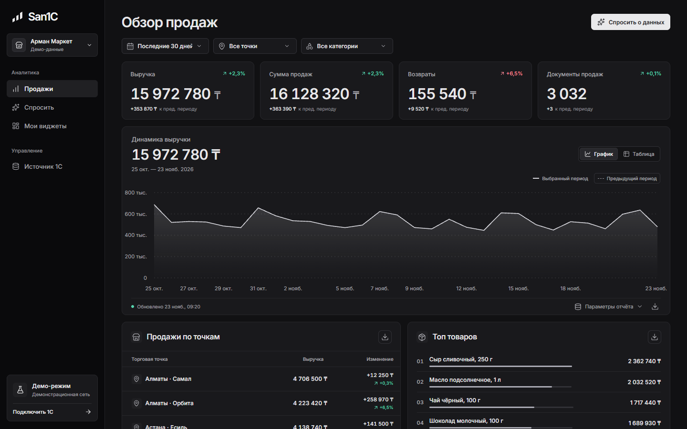
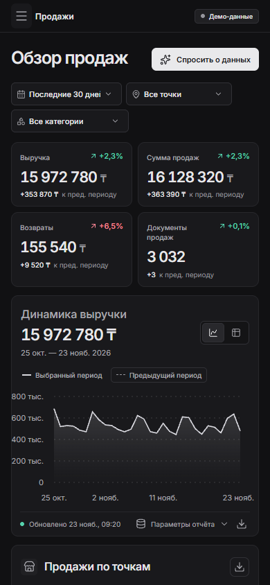
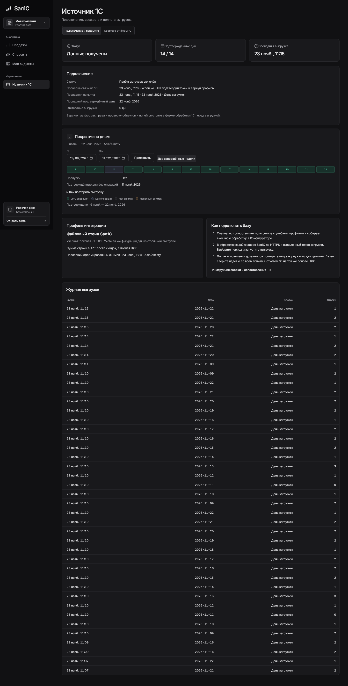
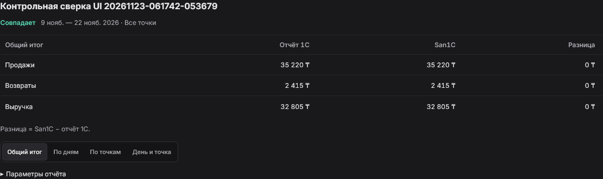
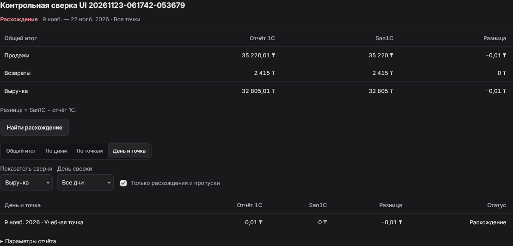
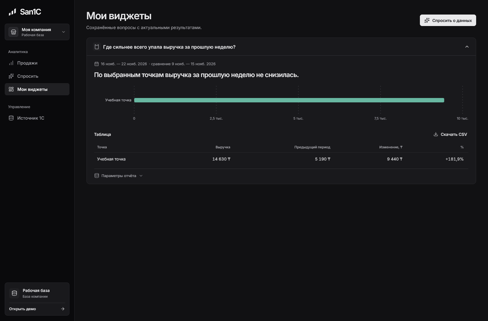

# Скриншоты San1C

Снимки сделаны в локальной демонстрации и на отдельном учебном стенде. Названия магазинов и операции вымышленные. Скриншоты показывают работу MVP, а не проверку клиентской УТ Казахстан 3.4.

## Дашборд

## Импорт из 1С и сверка

В протоколе двухнедельного прогона приведены контрольные суммы и команды повторения: ../pilot-result.md.
